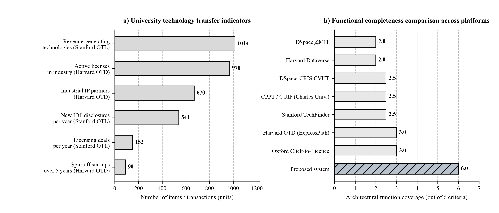
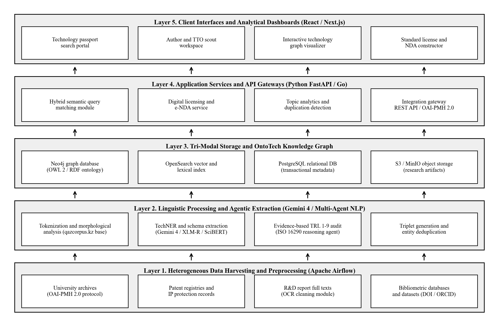
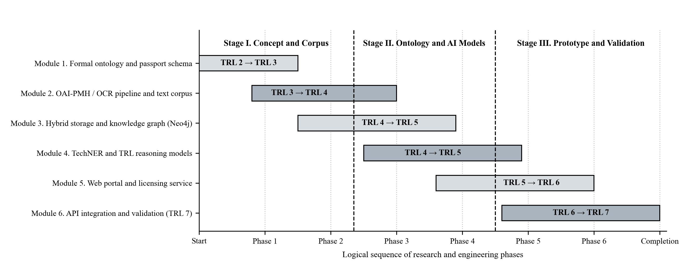

UDC 004.82:004.65:81'322

# METHODOLOGY FOR BUILDING A DIGITAL CORPUS AND ONTOLOGICAL REPOSITORY OF TECHNOLOGIES BASED ON CORPUS LINGUISTICS AND KNOWLEDGE GRAPHS

Bulbul D. Karbozova

PhD, Associate Professor

Satbayev University (KazNRTU named after K.I. Satpayev)

(Almaty, Kazakhstan)

E-mail: b.karbozova@satbayev.university

Emir Y. Toksanov

2nd Year Undergraduate Student

Satbayev University (KazNRTU named after K.I. Satpayev)

(Almaty, Kazakhstan)

E-mail: emirtoxsanov45@gmail.com

Abstract: This paper presents a methodology for designing a national digital corpus and ontological repository of technologies by adapting structural principles from computational corpus linguistics to scientific and technical knowledge engineering. We take the National Corpus of the Kazakh Language (qazcorpus.kz) as a baseline linguistic architecture and extend its subcorpus segmentation, metadata markup, and text processing pipeline to organize outputs from state-funded and grant-supported research and development (R&D) projects. To ground the system requirements, we compare six international university technology transfer and repository platforms: Stanford University, Harvard University, the University of Oxford, Charles University, the Massachusetts Institute of Technology (MIT), and the Czech Technical University in Prague (CVUT). We then define a five-layer software architecture that combines metadata harvesting via OAI-PMH 2.0, multilingual technical entity extraction and schema generation using encoder baselines alongside long-context foundation models (Gemini 4 Carbon and Argon) orchestrated in a multi-agent workflow, evidence-based assessment of Technology Readiness Levels (TRL 1 to 9) under ISO 16290, a tri-modal storage backend with a Neo4j knowledge graph, and an automated digital licensing module.

Keywords: corpus linguistics, technical corpus, ontological engineering, knowledge graph, digital technology repository, named entity recognition, multi-agent reasoning, technology readiness level, technology transfer.

## Introduction

Research centers and universities produce large volumes of technical documentation during state-funded and grant-supported research projects, including R&D final reports, patent specifications, utility model filings, source code repositories, and laboratory test protocols. In practice, over 50,000 such historical and ongoing records in Kazakhstan sit in fragmented registries or local archives as unstructured PDF files. Because there is no shared machine-readable semantic markup schema, engineers struggle to search for existing solutions by specific operating parameters, research administrators cannot systematically verify how mature a given technology actually is, and industrial partners face high friction when trying to license university outputs.

Computational and corpus linguistics address a very similar problem when organizing large unstructured text collections [1, 2]. In Kazakhstan, the main resource of this kind is the National Corpus of the Kazakh Language (qazcorpus.kz), which brings together 13 specialized subcorpora, a multi-field metadata markup window, and automated text processing utilities [3]. However, qazcorpus.kz covers mostly general, literary, and humanities texts, while a dedicated technical corpus for Kazakh and multilingual engineering documentation has not yet been built. Bringing together researchers from computational linguistics and software engineering makes it possible to adapt the structural principles of qazcorpus.kz to the domain of scientific and engineering documentation.

The goal of this study is to develop an architectural and ontological model for a national technical corpus and technology repository (QazTechCorpus) by combining corpus linguistics methods, OWL 2 knowledge graphs [4], multi-agent language model pipelines, and institutional repository practices from leading US and European universities. Specifically, we address four tasks: (1) defining how the three-level architecture of qazcorpus.kz should be extended for technical documentation; (2) comparing the structural and transactional mechanisms of six international university platforms; (3) specifying the OntoTech ontology, the multilingual entity extraction and TRL verification pipeline, and the hybrid search ranking model; and (4) outlining a staged implementation roadmap from TRL 2 to TRL 7.

## Methodological Continuity with Corpus Linguistics Architecture

Our methodology starts by mapping the structural layers of an established linguistic corpus onto a technical repository. In the National Corpus of the Kazakh Language (qazcorpus.kz), which builds on the domestic school of computational linguistics [1, 3], text organization follows three levels. The first level divides the text collection into 13 subcorpora (Main, Terminological, Educational, Parallel, Historical, Dialectal, Spoken, and others). The second level assigns document-level metadata through a markup window (author, title, functional style, chronology, target audience, distribution medium, and thematic category). The third level provides software modules for optical character recognition (tbiocr), lexical and card-index databases (tbisozdik, tbikartoteka), a concordancer, and a frequency analyzer [3].

Extending this three-level design to engineering and R&D documentation requires shifting the granularity of storage and analysis (Table 1). Instead of treating an isolated word form or lemma as the primary unit, the technical corpus centers on a unified Digital Technology Passport that links an R&D report, patent document, source code repository, engineering drawing, and laboratory test protocol. Linguistic subcorpora are replaced by six domain-specific technical collections, while morphological analyzers are paired with a domain-specific named entity extractor (TechNER), a multi-agent verifier for ISO 16290 Technology Readiness Levels [10], and a digital licensing engine.

### Table 1 - Structural comparison between the linguistic corpus qazcorpus.kz and the proposed technical corpus

| Architectural Element | Current Implementation in qazcorpus.kz | Proposed Adaptation in QazTechCorpus |
| --- | --- | --- |
| Primary storage unit | Annotated text, sentence, and word token with morphological tags linked to a lemma [3] | Digital Technology Passport linking an R&D report, patent, software repository, CAD drawing, and test protocol |
| Subcorpus structure | 13 linguistic subcorpora: Main, Terminological, Parallel, Educational, Historical, Dialectal, etc. | 6 technical subcorpora: R&D and grant project reports, patents, physical prototypes, software and AI models, datasets, industry R&D queries |
| Metadata markup schema | Author, title, style, audience, creation date, source type, thematic rubric [1, 3] | Authors (ORCID), rightsholder institution, IPC/CPC and OECD codes, maturity level TRL 1 to 9 [10], IP protection status, licensing terms |
| Search engine core | Lexico-grammatical concordancer, search by word form, lemma, and metadata attribute combinations | Hybrid search engine combining BM25 lexical matching, dense vector embeddings [16], and Cypher / SPARQL queries over a knowledge graph |
| Processing and service modules | OCR module tbiocr, dictionary database tbisozdik, card index tbikartoteka, frequency analyzer [3] | Scientific OCR cleaner, TechNER extractor (encoder baselines and Gemini 4 structured extraction) [5, 7], multi-agent TRL verifier, and license generator |

## Comparative Analysis of University Technology Transfer Platforms and Repositories

To define practical functional requirements for the technical corpus, we examined six international university infrastructures: Stanford University, Harvard University, the University of Oxford, Charles University, the Massachusetts Institute of Technology (MIT), and the Czech Technical University in Prague (CVUT). This sample covers both Anglo-American institutions with high-volume patent licensing offices and European universities that connect open institutional repositories directly to Current Research Information Systems (CRIS).

At Stanford University, the digital core of the Office of Technology Licensing (Stanford OTL) is the Stanford TechFinder portal (techfinder.stanford.edu) [15]. Every invention submitted through an Invention Disclosure Form (IDF) is published as a structured Non-Confidential Abstract that explains the engineering problem and practical applications without exposing proprietary details prior to patent filing. Faceted taxonomy categories (Physical Sciences and Life Sciences) connect to researcher pages in Stanford Profiles and relationship maps in Visible Legacy. According to Stanford OTL reports, the active portfolio includes 1,014 revenue-generating technologies, with 541 new IDF disclosures and up to 152 licensing or option agreements signed annually [15].

Harvard University separates its infrastructure into two distinct contours [9, 11]. The commercial contour is run by the Office of Technology Development (Harvard OTD, otd.harvard.edu), which manages 5,710 active patents and 970 active industry licenses across 670 corporate partners, resulting in 90 spin-off startups over five years [9]. A notable procedural mechanism at Harvard is the ExpressPath license template family across Engineering and Tech, Medical Devices, and Software, offering standardized terms with deferred upfront payments. The academic contour is built on Harvard Dataverse [11], an open data platform that assigns DataCite DOIs at both the dataset and individual file levels in line with FAIR data principles.

At the Massachusetts Institute of Technology (MIT), open scholarship and IP protection operate through the pairing of DSpace@MIT and the MIT Technology Licensing Office (TLO) showcase [14]. Built on OAI-PMH 2.0 and Qualified Dublin Core, DSpace@MIT hosts more than 60,000 technical reports, theses, and preprints with over 1 million monthly downloads [14], while the MIT TLO portal links scholarly publications to patent families. Similarly, the University of Oxford, through Oxford University Innovation (OUI), operates the Click-to-Licence portal and the OUI Software Store (process.innovation.ox.ac.uk) [13], which splits distribution into free Academic Use licenses and instant Commercial Use packages for computational libraries, simulators, and validated clinical scales.

At the Czech Technical University in Prague (CVUT), the digital library dspace.cvut.cz runs on DSpace-CRIS and maintains two-way synchronization with the national R&D registry (V3S) under the OpenAIRE 3.0+ specification [8], tracking journal papers alongside utility models (uzitny vzor) and functional engineering prototypes. Charles University in Prague combines its academic Centre for Knowledge and Technology Transfer (CPPT UK) with a wholly owned subsidiary, Charles University Innovations Prague (CUIP a.s.) [6], relying on faculty Innovation Scouts to identify and track early Proof-of-Concept developments at TRL 3 to 5.

*Figure 1 - Quantitative indicators of university technology transfer (a) and functional coverage of university platforms across six architectural criteria (b)*

Comparing these six systems (Figure 1, Table 2) points to a persistent split between two weakly connected software classes. Open institutional repositories (DSpace@MIT, Harvard Dataverse, DSpace-CRIS CVUT) support automated metadata harvesting via OAI-PMH, Dublin Core / DataCite schemas, and persistent DOI identifiers, but they lack tools for assessing TRL maturity or executing licensing transactions. Conversely, technology transfer showcases (Stanford TechFinder, Harvard OTD, Oxford Click-to-Licence) streamline patent packaging and deal execution, yet rely on manual curation by licensing managers and cover only a small fraction of commercially ready inventions. Combining both contours within a single corpus architecture backed by automated NLP and LLM metadata extraction bridges this gap.

### Table 2 - Comparative analysis of architectural mechanisms across US and European university platforms

| Platform and University | Core Technical and Procedural Mechanism | Functional Limitations | Adaptation in Proposed Technical Corpus |
| --- | --- | --- | --- |
| Stanford OTL & TechFinder (Stanford, USA) [15] | Open Non-Confidential Abstracts, faceted taxonomy, Visible Legacy relationship graphs | Manual abstract preparation by OTL staff; no OAI-PMH harvesting or automated TRL scoring | Dual-contour technology passport: open abstract generated by NLP/LLM pipeline and restricted dossier under e-NDA |
| Harvard OTD & ExpressPath (Harvard, USA) [9] | Standardized non-negotiable ExpressPath licenses across 3 industry tracks with deferred fees | No direct software link to primary R&D reports or source code repositories | Built-in generator for standardized licensing agreements covering software, instruments, and engineering methods |
| Harvard Dataverse (Harvard, USA) [11] | Virtual institutional collections, dataset- and file-level DOI registration, FAIR compliance | Focused on open research data without know-how protection or commercial licensing workflows | Isolated virtual subcorpora for research institutes with DataCite DOI support for open test protocols |
| DSpace@MIT & MIT TLO (Cambridge, USA) [14] | OAI-PMH 2.0 protocol, Qualified Dublin Core metadata, archive of 60,000+ reports and theses | Separation between open text archive in DSpace and commercial patent catalog in TLO | Automated OAI-PMH harvesting of university repositories with end-to-end links across paper, report, patent, and prototype |
| OUI Click-to-Licence (Oxford, UK) [13] | Online OUI Software Store splitting Academic Use and Commercial Use licensing in one click | Applicable mainly to transferable digital assets (software, databases, assessment scales) | Dedicated module for instant licensing of scientific software, trained AI weights, and digital corpora |
| DSpace-CRIS CVUT & CPPT/CUIP UK (Prague, Czechia) [6, 8] | Repository integration with CRIS V3S (OpenAIRE), utility model tracking, faculty scouts, and PoC monitoring | Confined to a single institution; no neural full-text extraction of engineering parameters | Innovation scout workspace and early-stage R&D tracking (TRL 3 to 5) with automated passport pre-filling |

## Architectural-Ontological Model and Algorithms for Processing Scientific and Technical Texts

The proposed digital corpus of technologies follows a five-layer microservice architecture (Figure 2) that handles the full lifecycle from ingesting raw unstructured PDFs to executing hybrid semantic queries and generating license agreements. Layer 1 manages asynchronous data ingestion orchestrated by Apache Airflow. It includes OAI-PMH 2.0 harvesters for polling institutional DSpace and Dataverse archives [11, 14], parsers for open patent registries (inventions, utility models, industrial designs, and software copyright certificates), bibliometric connectors (CrossRef, OpenAlex, ORCID), and a scientific OCR cleaning module that extends the diacritic and formula recognition rules of the tbiocr stack [3].

*Figure 2 - Five-layer software architecture of the digital corpus and ontological repository of technologies*

Layers 2 and 3 transform unstructured text streams into a formal knowledge graph [4]. The semantic core of the repository is the domain ontology OntoTech, specified in OWL 2 DL [12] as an ordered five-tuple:

O = ⟨C, R, A, I, X⟩,     (1)

where C denotes the finite set of domain concept classes (Technology, Patent, R&D Report, Software Module, Researcher, Organization, Equipment, Application Industry); R defines the set of directed object properties linking classes (developedAt, protectedByDocument, basedOnMethod, hasReadinessLevel, applicableInIndustry); A specifies the set of typed data attributes for each class; I represents the set of concrete passport and entity instances stored in the knowledge base; and X contains description logic axioms used by the reasoner to check metadata consistency whenever new records are ingested.

Under the OntoTech ontology, every object in the corpus is represented by a unified Digital Technology Passport organized into six faceted metadata blocks (Table 3). This structure combines bibliographic interoperability with DataCite and Dublin Core [11, 14], patent and subject classification codes (IPC/CPC, OECD Fields of Science), and transactional attributes adapted from Stanford TechFinder [15], Harvard ExpressPath [9], and Oxford Click-to-Licence [13].

### Table 3 - Structure of the six faceted metadata blocks of the Digital Technology Passport in the OntoTech ontology

| Passport Facet Block | Key Metadata Attributes and Entities | Supported Standards and Protocols |
| --- | --- | --- |
| 1. Identification block | Persistent passport identifier (DOI / Handle), R&D project registration number, trilingual title (Kazakh, Russian, English), record version, linked publications | DataCite Metadata Schema 4.5, Qualified Dublin Core, OAI-PMH 2.0 [11, 14] |
| 2. Engineering and industry taxonomy | International and Cooperative Patent Classification codes (IPC / CPC), OECD Fields of Science (FOS) rubrics, applied industrial domain tags | WIPO IPC / CPC, OECD Frascati Manual classification, OWL 2 RDF Schema [12] |
| 3. Technical specification and open abstract | Non-confidential summary, engineering problem solved, quantitative physical or algorithmic performance metrics, hardware and software stack | Stanford TechFinder Non-Confidential Abstract model [15] |
| 4. Maturity verification (TRL) | Assessed readiness level from TRL 1 to TRL 9, confidence score, direct citations to supporting evidence (calculation, bench prototype, lab test protocol) | ISO 16290:2013 international standard (TRL 1 to 9 scale) [10] |
| 5. Legal status and IP protection | IP object type (invention patent, utility model, software or database certificate, trade secret), registry number, rightsholders, and authors (ORCID) | WIPO ST.9 bibliographic patent data standards |
| 6. Transfer and licensing profile | Available transfer mode: academic or commercial Click-to-Licence, ExpressPath startup package, sponsored research contract, e-NDA data room mode | Oxford OUI Software Store [13] and Harvard ExpressPath [9] protocols |

Because primary R&D reports and grant deliverables arrive as unstructured documents written in Kazakh, Russian, and English, manual passport entry leads to severe catalog incompleteness. To generate draft passports automatically at Layer 2, we implement a hybrid linguistic and multi-agent neural pipeline. During morphosyntactic preprocessing, the pipeline accounts for the agglutinative morphology of the Kazakh language, where sequences of case and possessive suffixes attached to compound technical terms create high surface-form sparsity [1, 3]. Normalizing stems through the tbisozdik terminological dictionaries and qazcorpus.kz morphological analyzers stabilizes token representations before neural extraction.

For domain-specific named entity recognition (the TechNER module) and structured passport synthesis, we combine fine-tuned encoder baselines, specifically multilingual XLM-RoBERTa [7] and scientific SciBERT [5] with a Conditional Random Field (CRF) output layer, alongside long-context foundation models (Google Gemini 4 Carbon and Gemini 4 Argon) operating in a coordinated multi-agent workflow. While token-level encoder baselines provide fast span extraction on short abstracts, long-context Gemini 4 models ingest complete 50- to 100-page R&D reports, tables, and test charts in a single pass to produce schema-validated JSON outputs conforming to OntoTech. Across both extraction tracks, the system identifies ten target entity classes: created technical artifact or substance (TECH_ARTIFACT), method or algorithm (TECH_METHOD), quantitative operating parameters (QUANT_PARAM, such as purity, efficiency, accuracy, or temperature and pressure bounds), raw materials and reagents (MATERIAL), laboratory and industrial equipment (EQUIPMENT), software stack (SOFTWARE_STACK), application sector (DOMAIN), IP and technical standard identifiers (IP_STD), empirical test evidence (TRL_EVIDENCE), and partner organizations (ORG). Multi-class extraction performance is evaluated via macro-averaged F1:

F1 = (1 / K) ∑ (2 · Pk · Rk) / (Pk + Rk),     (2)

where K = 10 is the number of target technical entity classes, and Pk and Rk denote Precision and Recall for the k-th entity class on a held-out expert-annotated benchmark set.

To diagnose technology maturity along the nine-level ISO 16290 scale (TRL 1 to 9) [10], we pair deterministic production rules with an adversarial multi-agent verification workflow powered by Gemini 4 Carbon. First, deterministic rules verify the presence of required documentary artifacts (analytical calculations for TRL 2 to 3, laboratory test protocols and bench setups for TRL 4, patent filings and relevant-environment test acts for TRL 5 to 6, and industrial pilot acts for TRL 7). Next, an independent Evidence Auditor agent cross-checks the extracted claims against quantitative test tables and ISO 16290 criteria, outputting a probability distribution over TRL classes along with exact verbatim quotes and page citations for final review by the author or technology transfer officer.

Data persistence at Layer 3 is split across three specialized database engines: Neo4j stores semantic triples governed by the OntoTech ontology, OpenSearch indexes full texts alongside dense cross-lingual vector representations from Multilingual-E5 [16] and Google text embeddings, and PostgreSQL paired with S3/MinIO object storage handles transactional user accounts, file versioning, and licensing audit logs. When an engineer or industrial partner submits a search query, candidate technology passports are ranked by a linear combination of three normalized scores:

S(q, d) = α · SBM25(q, d) + β · cos(vq, vd) + γ · Sgraph(q, d),     (3)

where SBM25(q, d) captures exact lexical matches for nomenclature indices, IPC codes, and chemical formulas; cos(vq, vd) measures the cosine similarity between dense 1024-dimensional cross-lingual embeddings of the query and the passport [16]; and Sgraph(q, d) reflects structural graph connectivity in Neo4j (such as verified test protocols and linked IP records). The non-negative weights satisfy α + β + γ = 1 and are tuned on a validation set of domain retrieval tasks.

To prevent premature disclosure of trade secrets and know-how prior to patent filing, Layers 4 and 5 enforce strict two-tier access control. The public catalog exposes only author-approved Non-Confidential Abstracts following the Stanford TechFinder model [15], after an automated sanitization filter strips proprietary chemical formulations and unpublished code snippets. Full technical dossiers (CAD blueprints, raw test protocols, and engineering calculations) reside in a virtual data room accessible only after signing an electronic non-disclosure agreement (e-NDA), while software packages, datasets, and analytical methods can be licensed directly through standardized workflows modeled on Oxford Click-to-Licence [13] and Harvard ExpressPath [9].

## Staged Development and Validation Roadmap for the Technical Corpus

Practical implementation and validation of the proposed methodology are organized into six interconnected research and engineering modules (Modules 1 to 6) grouped across three sequential stages. This roadmap advances the platform from an initial conceptual specification (TRL 2) to a full-scale system prototype demonstrated in an operational university and industrial environment (TRL 7 under ISO 16290 [10]). Figure 3 illustrates the logical progression of the six modules.

*Figure 3 - Staged research and development roadmap (Modules 1 to 6) and system maturity trajectory (TRL 2 to TRL 7)*

Stage I (advancing from TRL 2 to TRL 4) covers Modules 1 and 2. Module 1 formalizes the OntoTech ontology in Protege (over 250 classes and 80 object property types in OWL 2 [12]), aligns IPC/CPC and OECD taxonomies, and establishes legal templates for open and commercial license offers. Module 2 builds asynchronous OAI-PMH 2.0 and REST API harvesters, adapts the scientific OCR cleaning pipeline from qazcorpus.kz [3], and compiles an initial verified trilingual technical subcorpus of at least 15,000 documents drawn from R&D project reports and patent descriptions. Bridging Stages I and II, Module 3 deploys the containerized tri-modal storage cluster (Neo4j, OpenSearch, PostgreSQL, S3), implements author and institution entity deduplication, and populates the initial knowledge graph (25,000 nodes and approximately 120,000 semantic triples with hybrid query latency below 150 ms).

Stage II (reaching TRL 5) focuses on Module 4 and initiates the client services of Module 5. Under Module 4, the team compiles an open, expert-annotated gold benchmark dataset of 5,000 scientific and technical texts in Kazakh, Russian, and English labeled across the ten engineering entity classes and ISO 16290 maturity levels. We benchmark fine-tuned encoder models (XLM-RoBERTa, SciBERT) [5, 7] against multi-agent long-context workflows powered by Gemini 4 Carbon and Argon, targeting a macro-averaged F1 score of at least 0.86 on TechNER extraction and at least 0.82 accuracy on automated TRL classification, alongside empirical calibration of the hybrid ranking weights in Equation (3).

Stage III (advancing from TRL 5 to TRL 7) completes the trilingual web portal (Module 5) and conducts system-wide integration testing (Module 6). The web platform delivers a faceted search showcase, an interactive subgraph visualizer, dedicated workspaces for researchers and innovation scouts (adapted from the Charles University model [6]), a virtual data room with e-NDA signing, and a one-click licensing module for software and engineering outputs. In Module 6, the corpus scales to 50,000 technology passports and 250,000 semantic triples, connects to university CRIS systems and DSpace/Dataverse archives via an Open API gateway, and undergoes load and retrieval accuracy evaluation with partner research laboratories and industrial engineering teams.

## Conclusions

1. By combining methods from computational corpus linguistics and knowledge engineering, this study establishes a practical methodology for building a national technical corpus and technology repository in Kazakhstan (QazTechCorpus). Extending the three-level architecture of the National Corpus of the Kazakh Language (qazcorpus.kz) around a unified Digital Technology Passport makes it possible to systematically index and verify outputs from state-funded and grant-supported R&D projects.

2. A comparative evaluation of digital platforms at Stanford, Harvard, Oxford, Charles University, MIT, and CVUT shows a clear functional split between open scholarly repositories (OAI-PMH, FAIR, DataCite DOI) and commercial technology transfer showcases (Non-Confidential Abstracts, ExpressPath, and Click-to-Licence). Our five-layer architecture unifies both contours while protecting unpublished know-how through a two-tier passport design.

3. We have specified the formal OWL 2 ontology OntoTech, a six-block faceted metadata schema, a hybrid extraction pipeline combining encoder baselines with multi-agent long-context reasoning (Gemini 4 Carbon and Argon) across ten technical entity classes (TechNER), an evidence-based ISO 16290 TRL 1 to 9 verification method, and a lexical-vector-graph ranking formula. The six-module roadmap provides a clear path from conceptual specification (TRL 2) to an operationally validated platform (TRL 7) and an open 5,000-document trilingual benchmark for the research community.

## REFERENCES:

1. Zhubanov A.K. Corpus linguistics as a new direction in Kazakh linguistics // Bulletin of KazNU. Philological Series. - 2014. - No. 3 (149). - P. 18-24.

2. Zakharov V.P., Bogdanova S.Yu. Corpus Linguistics: Textbook. - 3rd ed., rev. - St. Petersburg: St. Petersburg State University Press, 2020. - 234 p.

3. National Corpus of the Kazakh Language (Qazcorpus): Subcorpus Structure and Metadata Markup System [Electronic resource]. - URL: https://qazcorpus.kz/indexru.php (accessed: 05.11.2026).

4. Khoroshevsky V.F. Knowledge spaces on the Internet and Semantic Web // Artificial Intelligence and Decision Making. - 2008. - No. 1. - P. 80-97.

5. Beltagy I., Lo K., Cohan A. SciBERT: A Pretrained Language Model for Scientific Text // Proceedings of the 2019 Conference on Empirical Methods in Natural Language Processing (EMNLP-IJCNLP). - Hong Kong: ACL, 2019. - P. 3615-3620.

6. Centre for Knowledge and Technology Transfer of Charles University (CPPT UK) and Charles University Innovations Prague (CUIP) [Electronic resource]. - URL: https://cppt.cuni.cz/CPPTNEN-79.html (accessed: 05.11.2026).

7. Conneau A., Khandelwal K., Goyal N. et al. Unsupervised Cross-lingual Representation Learning at Scale // Proceedings of the 58th Annual Meeting of the Association for Computational Linguistics (ACL). - 2020. - P. 8440-8451.

8. Digital Library of the Czech Technical University in Prague (DSpace CVUT) and CTU Open Science Strategy [Electronic resource]. - URL: https://dspace.cvut.cz/ (accessed: 05.11.2026).

9. Harvard Office of Technology Development: ExpressPath Licenses and Available Technologies [Electronic resource]. - URL: https://otd.harvard.edu/researchers/licensing-startup-formation/harvard-expresspath-licenses/ (accessed: 05.11.2026).

10. ISO 16290:2013. Space systems - Definition of the Technology Readiness Levels (TRLs) and their criteria of assessment. - Geneva: International Organization for Standardization, 2013. - 16 p.

11. King G. An Introduction to the Dataverse Network as an Infrastructure for Data Sharing // Sociological Methods & Research. - 2007. - Vol. 36, No. 2. - P. 173-199.

12. OWL 2 Web Ontology Language Document Overview (Second Edition): W3C Recommendation [Electronic resource]. - URL: https://www.w3.org/TR/owl2-overview/ (accessed: 05.11.2026).

13. Oxford University Innovation: Click-to-Licence Portal and Software Store [Electronic resource]. - URL: https://process.innovation.ox.ac.uk/software/ (accessed: 05.11.2026).

14. Smith M., Barton M., Bass M. et al. DSpace: An Open Source Dynamic Digital Repository // D-Lib Magazine. - 2003. - Vol. 9, No. 1. - P. 1-14.

15. Stanford Office of Technology Licensing and TechFinder Portal [Electronic resource]. - URL: https://techfinder.stanford.edu/ (accessed: 05.11.2026).

16. Wang L., Yang N., Huang X. et al. Multilingual E5 Text Embeddings: A Technical Report // arXiv preprint arXiv:2402.05672. - 2024. - P. 1-8.
