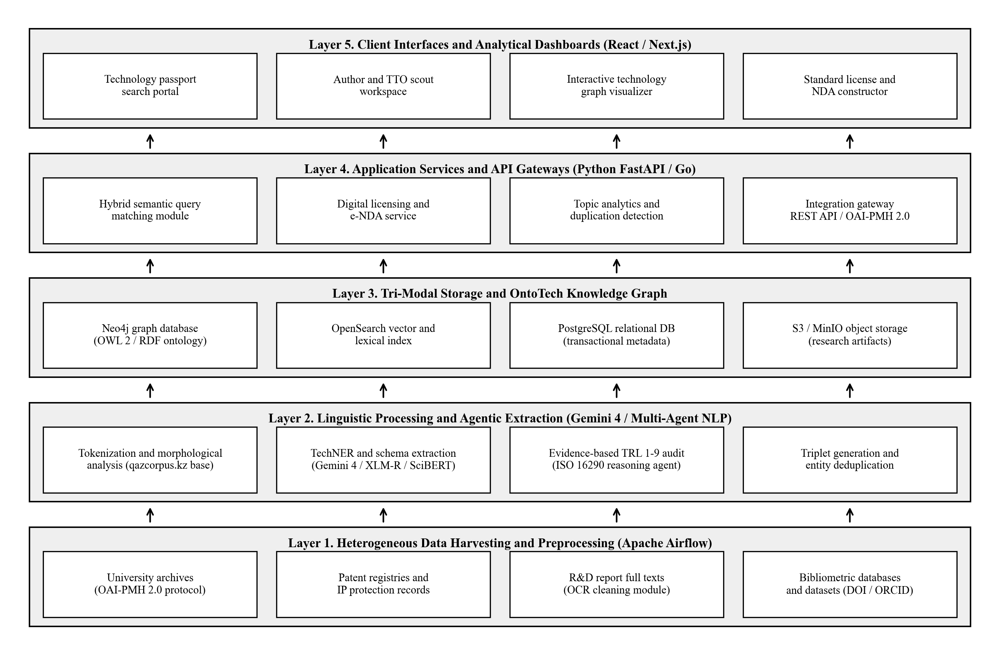

# QazTechCorpus: National Digital Corpus and Ontological Repository of Technologies

**Institution:** Satbayev University (Kazakh National Research Technical University named after K.I. Satpayev), Almaty, Kazakhstan  
**Principal Investigator:** Dr. Bulbul D. Karbozova, PhD, Associate Professor (`b.karbozova@satbayev.university`, [ORCID: 0000-0002-9287-5319](https://orcid.org/0000-0002-9287-5319))  
**Co-Investigator & Lead Research Engineer:** Emir Y. Toksanov (`emirtoxsanov45@gmail.com`)

---

## Overview

**QazTechCorpus** is an open scientific research project that adapts structural methodologies from computational corpus linguistics (specifically the National Corpus of the Kazakh Language, `qazcorpus.kz`) to scientific and technical knowledge engineering. The platform transforms unstructured trilingual R&D reports, doctoral dissertations, patent specifications, and laboratory test protocols (Kazakh, Russian, and English) into a formal OWL 2 knowledge graph (**OntoTech**) with automated evidence-based Technology Readiness Level (TRL 1 to 9) verification under **ISO 16290:2013**.

---

## Repository Structure

- [`Article_QazTechCorpus_Digital_Technology_Corpus_EN.md`](Article_QazTechCorpus_Digital_Technology_Corpus_EN.md) ([`.docx`](Article_QazTechCorpus_Digital_Technology_Corpus_EN.docx)): Full peer-reviewed research paper detailing the methodological continuity with `qazcorpus.kz`, the benchmark across six international university platforms (Stanford OTL, Harvard OTD/Dataverse, MIT DSpace/TLO, Oxford Click-to-Licence, CVUT DSpace-CRIS, Charles University CPPT/CUIP), the formal `OntoTech` OWL 2 model, and the multi-agent extraction and retrieval equations.
- [`Research_Statement_Antigravity_Science_EN.md`](Research_Statement_Antigravity_Science_EN.md) ([`.docx`](Research_Statement_Antigravity_Science_EN.docx)): 12-month research statement for multi-agent scientific reasoning and long-context extraction using Google Antigravity and Gemini 4 Carbon / Argon.
- [`Grant_Proposal_QazTechCorpus_Executive_Dossier_EN.md`](Grant_Proposal_QazTechCorpus_Executive_Dossier_EN.md) ([`.docx`](Grant_Proposal_QazTechCorpus_Executive_Dossier_EN.docx)): 36-month executive grant proposal dossier covering Stages I to III (Modules 1 to 6, advancing from TRL 2 to TRL 7).
- [`ontology/ontotech.ttl`](ontology/ontotech.ttl): Core OWL 2 DL specification (`O = <C, R, A, I, X>`) defining classes, object properties, data attributes, and consistency axioms for Digital Technology Passports.
- [`qaztechcorpus/passport_schema.py`](qaztechcorpus/passport_schema.py): Reference Python implementation of the six-block faceted Digital Technology Passport schema, the 10-class `TechNER` structured extraction validator, the ISO 16290 `TRL 1 to 9` evidence auditor, and the hybrid lexical-vector-graph ranking function `S(q, d)`.
- [`Figures/`](Figures/): High-resolution architectural diagrams and comparative university transfer benchmarks.

---

## Core Mathematical Formulations

### 1. OntoTech Domain Ontology
$$O = \langle C, R, A, I, X \rangle$$
where $C$ denotes domain concept classes (`Technology`, `Patent`, `RnDReport`, `SoftwareModule`, `Researcher`, `Organization`, `Equipment`, `IndustryDomain`), $R$ defines directed object relations, $A$ specifies typed data properties, $I$ represents knowledge base instances, and $X$ contains description logic axioms checked by the OWL 2 reasoner.

### 2. Multi-Class TechNER Evaluation
$$F_1 = \frac{1}{K} \sum_{k=1}^{K} \frac{2 \cdot P_k \cdot R_k}{P_k + R_k}, \quad K = 10$$
evaluated across 10 technical entity classes: `TECH_ARTIFACT`, `TECH_METHOD`, `QUANT_PARAM`, `MATERIAL`, `EQUIPMENT`, `SOFTWARE_STACK`, `DOMAIN`, `IP_STD`, `TRL_EVIDENCE`, and `ORG`.

### 3. Hybrid Lexical-Vector-Graph Retrieval
$$S(q, d) = \alpha \cdot S_{\text{BM25}}(q, d) + \beta \cdot \cos(v_q, v_d) + \gamma \cdot S_{\text{graph}}(q, d), \quad \alpha + \beta + \gamma = 1$$

---

## License

Released under the **Apache License 2.0** for code and ontology specifications, and **CC-BY 4.0** for documentation and benchmark schemas.
